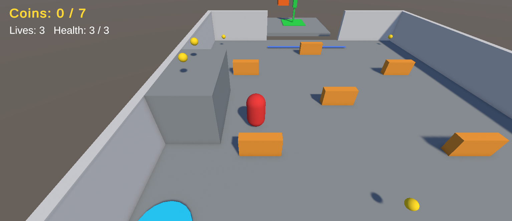
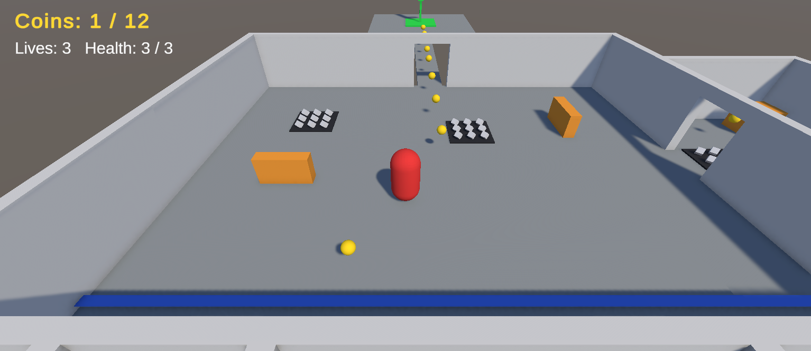
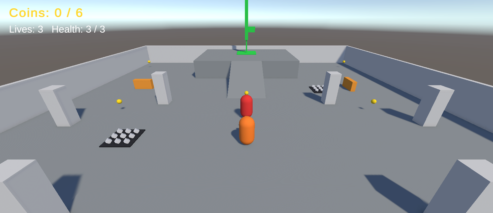
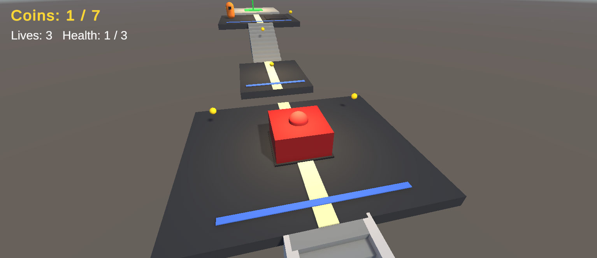
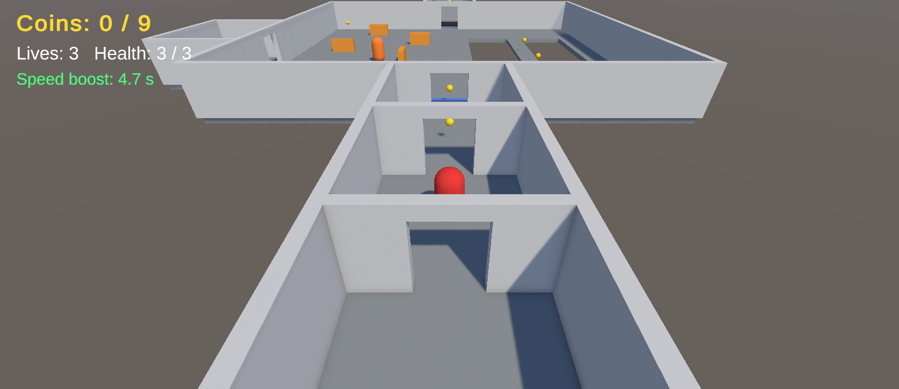

# CS464 Assignment 03, Mohsin Raza Ojla, BSSE23040

- **Video (about 2 minutes):** VIDEO_LINK_HERE
- **Started from:** my Assignment 02 repo, https://github.com/bsse23040/CS464-A2-BSSE23040. I copied it with its history, so the five levels, the controller and the camera are the same. Everything new in this assignment is added on top.
- **Controls:** `W A S D` or the arrow keys to move, `Space` to jump. They use the Input System actions `Move` and `Jump`.
- **To win a level:** collect the coins shown at the top left (7, 12, 6, 7 and 9 in levels 1 to 5) and then stand on the green goal. If you have too few coins, the goal tells you how many are missing. You have 3 lives with 3 hearts each, and falling off the level costs a life.

Made and tested in Unity 6000.6.2f1.

## Levels

| Level | Screenshot | New idea | Combined with |
|---|---|---|---|
| Level01 |  | Coins, the goal and a bounce pad that throws you onto a ledge with two coins. | Nothing hurts yet. The only danger is the 2.5 m gap before the goal, with a checkpoint in front of it. |
| Level02 |  | Spikes, which cost one heart at a time. | A coin trail that goes over spikes, and a reward room with spikes in the doorway that you have to jump. |
| Level03 |  | A guard that patrols, chases when you come close and gives up when you get away. | Spikes right beside its route, so dodging the guard can push you into them. |
| Level04 |  | The crusher, which warns before it hits. You meet it alone on the first platform, with a coin on it. | A guard that walks next to a second crusher on the last platform, after the two 2.5 m jumps and the stairs. |
| Level05 |  | Two speed pickups 6 m apart, so you grab the second one while the first is still running. | Everything from before: a ping-pong guard, spikes, a crusher across the ramp room, the narrow bridge and the 2.8 m jump at the end. |

## The numbers

| Number | Value | Why |
|---|---|---|
| Patrol speed | 2 m/s | The player runs at 5 m/s, so the guard walks at 40% of that. You have time to see its route and walk past. |
| Chase range | 6 m, gives up at 9 m. Chase speed 3.5 m/s | One jump carries about 5 m, so with 6 m you cannot jump past a guard without it noticing. It gives up 3 m further out so it does not switch on and off at one edge. 3.5 m/s is 70% of my run speed, so I can always outrun it. |
| Knockback | 8 with `ForceMode.Impulse` (the crusher uses 10), and no steering for 0.25 s | On the 1 kg player an impulse of 8 gives 8 m/s, and for 0.25 s that is about 2 m. I measured 1.9 m in play, which gets me out of the 2 m spike patch. |
| I-frames | 1 s | After a hit, the knockback plus a short walk gets you out of a 2 m patch in under a second. That is long enough to get clear, and standing in spikes still costs a heart every second. |
| Power-up duration | 5 s at x1.6 speed (8 m/s) | That is about 40 m of running. It covers the pickups 6 m apart in level 5 but not the whole level, so it helps without becoming the normal speed. |
| Crusher warning | 0.7 s (rest 2.4 s, strike 0.4 s) | Reaction time is about 0.25 s and you also have to move, so 0.7 s is fair. 0.2 s would feel unfair. |
| Bounce pad | 9 m/s up with `ForceMode.VelocityChange` | The top of the jump is v squared over 2g, which is 4.1 m. The ledge is 3 m high, so there is some room. |
| Respawn | 0.6 s delay, 1.5 s protection | The delay lets the knockback of the killing hit finish before the new life starts, and the protection stops the spawn point from killing twice. |

## Short answers

**1. Why does a trigger need a Rigidbody on at least one of the two objects?**

Unity only reports a trigger when at least one of the two colliders has a Rigidbody. Two colliders without one are both static, so they are never checked against each other and nothing happens. In my game the player has the Rigidbody, so the coins, spikes, goal and checkpoints work even though they have none. The guards move by script, so I gave them a kinematic Rigidbody, because a collider that moves should have one.

**2. Which ForceMode do your knockback and your Part A force use, and why each?**

The knockback uses `Impulse`. It is one kick and I want the mass to count: 8 on a 1 kg player is 8 m/s. It is called once, from `OnTriggerStay`, only when the hit lands. The bounce pad uses `VelocityChange`, so the height depends only on the number and not on the mass (9 m/s gives 4.1 m). It kicks once from `OnTriggerEnter`. My controller sets the sideways speed every physics step, so the pad only pushes straight up, and the knockback turns off the steering for 0.25 s so the push is not wiped.

**3. What does your code do when a second power-up is picked up while one is running?**

It refreshes it. `BoostSpeed` stops the running coroutine and starts a new one, so the 5 seconds start again and the speed does not stack. Two pickups 3 seconds apart would end at 8 seconds. In level 5 the second pickup takes the boost from about 2.2 seconds left back up to 5.

**4. Why can `==` fail as an arrival check, and when does it work?**

`Vector3 ==` only says true when the positions are within about 0.00001 m. If I move an object by hand with steps of about 3 cm per frame, it never lands that close, so it overshoots, turns round and never arrives. It does work right after `Vector3.MoveTowards`, because that lands exactly on the target when it is within one step. My guard checks arrival by distance anyway, with `arriveDistance` 0.1 m, which is bigger than one step (2 m/s is about 3 cm a frame), so it also works for the chase and the walk back.
